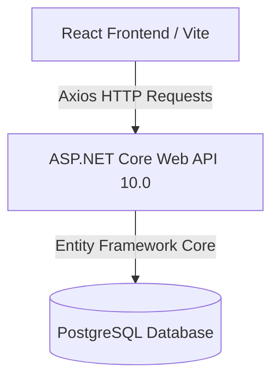

# SupportDesk - Professional SLA Tracking & Support Ticket System

A modern, enterprise-grade, full-stack Support Ticket System designed for internal company usage and customer triage management. Built with a clean, scalable architecture, premium responsive dark-mode aesthetics, dynamic Role-Based Access Control (RBAC), and full bilingual Turkish/English localization.

---

## 🌟 Key & Premium Features

### 1. High-Fidelity Pre-Login Welcome Portal
- **Rich Dark-Mode Visual Aesthetics:** Styled with sleek gradients, glassmorphism panel backdrops, custom biotech and micro-animations.
- **Real-Time SLA & KPI Indicators:** Displays SLA Adherence metrics (e.g. 99.9%), response latency times (<15 Min), collaborative triage distributions, and active system health.
- **Multi-Role Entry Desks:** Split-desks tailored for Employees/Clients and Support Agents/Administrators.

### 2. Dynamic RBAC with Individual User Overrides
- **Dual-Pane Permissions Dashboard:** 
  - **Static Role Defaults:** A transparent summary card of permissions mapped out for Admins, Agents, and Employees.
  - **Granular Custom Overrides:** A list allowing administrators to search users, modify their active roles, and toggle 8 distinct permission switches (e.g. status change, comment deletion) saving overrides instantly into the browser environment.
- **Client-Side Permission Enforcement:** If an Employee or Support Agent is granted a custom override to update a ticket's status, the dropdown dynamically unlocks for them in real time on the Ticket Detail page!

### 3. Fully Bilingual Localization (TR / EN)
- **Global Translation Engine:** Leverages a lightweight, highly-optimized Zustand-driven language store with complete support for Turkish and English.
- **Cohesive Language Selector:** A floating glass-globe dropdown selector present across the pre-login welcome page, login/register portals, client dashboards, and administrative screens.
- **Seamless Localized UI Assets:** Localizes all dynamic statuses, priority levels, categories, form inputs, placeholder prompts, card descriptions, warning banners, and administrative logs.

### 4. Interactive Ticket & Comment Triage
- **Process History & Progress Logging:** Provides detailed activity tracking and sequential comments on ticket detail pages.
- **Administrative Deletion:** Admins can delete irrelevant comment notes with a customized warning modal that overlays beautifully on top of existing processes.
- **Dynamic State Locks:** Blocks standard clients from changing bilet statuses or priorities unless explicitly customized by an administrator.

### 5. Custom Corporate Branding
- **Futuristic 3D Vektörel Favicon:** A customized dark-neon glowing Ticket badge replacing standard Vite presets.
- **Smart Back-Navigation:** Placed a floating, motion-animated back-navigation button on login and registration pages to instantly return users to the Welcome screen.

---

## 🛠️ Tech Stack

### Frontend (Client-side)
- **Core Library:** React 18, TypeScript, Vite
- **Styling:** Tailwind CSS 3 & Custom Glassmorphic HSL Tokens
- **State Management:** Zustand (Auth Store & Language Store)
- **HTTP Client:** Axios (Centralized API client with interceptors)
- **Icons:** Lucide-React

### Backend (Server-side)
- **Runtime:** ASP.NET Core Web API 10.0
- **Database ORM:** Entity Framework Core
- **Database Engine:** PostgreSQL
- **Security:** JWT (JSON Web Tokens) Bearer Auth, BCrypt password hashing
- **Deployment:** Docker & Docker Compose

---

## 📁 Architecture Overview



### Backend Directory Structure
- `Models/`: Core Domain entities, system role declarations, and database schemas.
- `DTOs/`: Scalable request/response data shapes.
- `Services/`: Decoupled business logic implementations.
- `Data/`: DB Context configuration, migration scripts, and entity modeling.
- `Controllers/`: Secure HTTP routes and authorization filters.

### Frontend Directory Structure
- `src/components/`: Reusable common components (e.g. Language Selector, Form Inputs).
- `src/pages/`: Page containers (e.g. Welcome Page, Login/Register portals, Dashboards, Ticket Details).
- `src/store/`: Centralized state management stores (Auth and Translation stores).
- `src/locales/`: Localization mapping dictionaries (`translations.ts`).
- `src/lib/`: Axios client initialization and response handling.

---

## 🚀 Setup & Local Execution

### Prerequisites
- .NET 10.0 SDK
- Node.js 20+
- PostgreSQL Server instance (or Docker Desktop)

### 1. Database Setup
1. Ensure your PostgreSQL server is active.
2. Configure the database connection string in `backend/appsettings.json`.
3. Apply migration scripts to build the schemas:
   ```bash
   cd backend
   dotnet ef database update
   ```

### 2. Backend Bootup
```bash
cd backend
dotnet run
```
*API Swagger documentation will instantly boot up at: `http://localhost:5128/swagger`*

### 3. Frontend Bootup
```bash
cd frontend
npm install
npm run dev
```
*The React app will instantly boot up at: `http://localhost:5173/`*

---

## 🔒 Administrative Credentials

- **Admin Username:** `admin`
- **Default Password:** `123456`

---

## 📝 Recent Releases & Improvements
- [x] Implemented Pre-Login Corporate Welcome Page.
- [x] Implemented Granular User Permission Toggles and Overrides.
- [x] Added dynamic role assignment drop-downs to admin screen.
- [x] Configured Turkish / English translation libraries across all pages.
- [x] Custom glowing 3D ticket browser icon and matching page titles.
- [x] Smooth back navigation flows on authorization portals.
